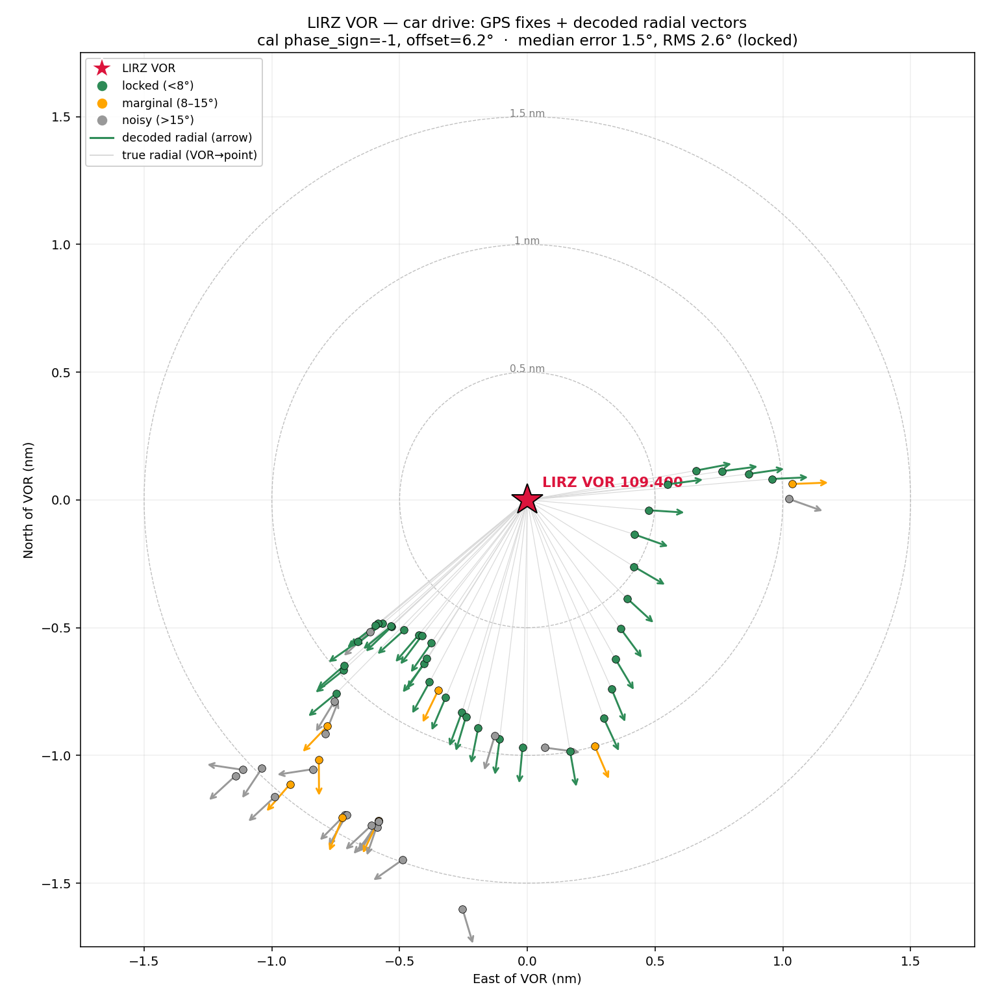
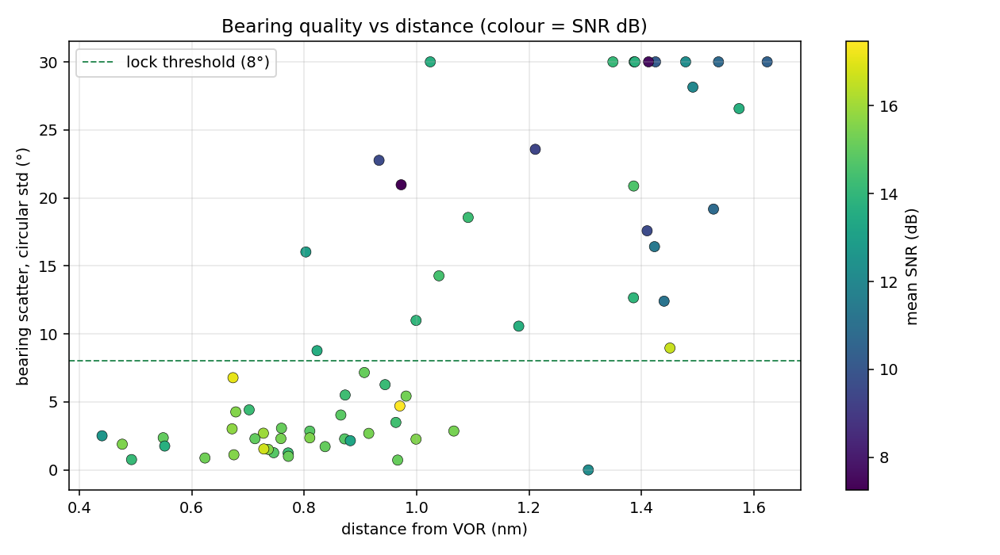

# RB-VOR

Software VOR receiver for RB-Avionics. An RTL-SDR dongle and a Raspberry Pi
decode a VHF Omnidirectional Range station and publish the radial into the
RB-Avionics bridge.

> **Supplemental / non-required equipment.** Day VFR situational awareness only.
> Not a certified NAV receiver. Not for IFR navigation or approach guidance.
> Independent primary navigation is assumed present. `vorradial` is usable only
> when `vorstatus >= 4` — consumers must honour that; every other field is a
> measurement, published whatever the status.

Part of the RB-Avionics platform · `xiaprojects/rb-vor` · https://www.rbavionics.com

---

## Quick start on a Raspberry Pi

```bash
git clone https://github.com/xiaprojects/rb-vor && cd rb-vor
sudo ./install.sh
cd /opt/rb-vor
python3 -m rbvor --self-test                      # no hardware needed
python3 tools/vor_calibrate.py --json /tmp/bearing.json
# merge the "bearing" block into /etc/rb-vor/rb-vor.json
python3 -m rbvor --config /etc/rb-vor/rb-vor.json --freq 109.4 --dry-run
```

**Running on a real Pi: [`RUN.md`](RUN.md)** — copy-paste path from a bare
image to a decoded 109.40 MHz bearing.
**Full bench procedure with expected output at every step:
[`docs/bench-test.md`](docs/bench-test.md).**

## Status — v0.9.0 bench release

| Milestone | State |
|---|---|
| M0 repo skeleton, CI | done |
| M1 `freqrules.py` + 200-channel test | done, 260 tests green |
| M2 `vor_gen.py` + `vor_spectrum.py` | done, 297 tests green |
| M3 `dsp.py` + `vor_replay.py` | done, 335 tests green |
| M4 bearing, quality, calibration | done, 380 tests green |
| M5 `sdr.py` live reader + self-test + bench guide | done, 501 tests green |
| M6 `config.py` + schema + `controller.py` | done, 424 tests green |
| M7 `bridge_client.py` + `publisher.py` + `mock_bridge.py` | done, 468 tests green |
| M8 packaging, systemd, installer, IF spec | done |
| M9 recording + cloud schema | done |
| Interface v2.0 (`vorradial`/`vorsnr`/`voram`, transmit-on-change) | done |
| Interface v2.1 (`vorstatus`/`vorsub`, SDR released when idle) | done |
| Interface v2.2 (`vorfreqactive`, status 4/5 split, payload never zeroed, `--csv`) | done — 1.0.0 |
| A22 offset-convention fix, F3/F5 daemon-liveness fixes, D6 hot-path 3.5× | done |
| A25 signal chain (filters, 2 s windows, AFC), D7 harmonic estimator (opt-in) | done, 550 tests green — bearing RMS halved, 4× at low SNR with D7 |
| M10 field campaign | **in progress** — an orbit was flown (see `CLAUDE.md`, "Field campaign"); the GPS-referenced evidence is not yet in the tree (O14) |

Everything except the field campaign is implemented. The interface is
**RB-VOR-IF v2.2** ([`docs/RB-VOR-IF-v2.2.md`](docs/RB-VOR-IF-v2.2.md)); v1.0,
v2.0 and v2.1 are retained for reference. See [`CHANGELOG.md`](CHANGELOG.md) for
measured performance and known limitations.

> **An uncalibrated config publishes no bearing** — `vorradial` stays 0 and
> `vorstatus` never reaches 4, while the signal measurements are published
> normally. That is deliberate — an uncalibrated bearing looks plausible and is
> wrong, which is the worst failure this system has. The shipped config carries
> the flight-validated calibration (1.0.0).

---

## Example: field test at LIRZ (109.400 MHz)

A drive around the LIRZ VOR with GPS fixes, each decoded radial compared with
the true radial from the station to the GPS position.



Each dot is a GPS fix, the thin grey line is the true radial (VOR → point) and
the arrow is the decoded radial. Green = locked (scatter < 8°), orange =
marginal (8–15°), grey = noisy (> 15°). Over the locked fixes the median error
is **1.5°** and the RMS **2.6°**. Arrows follow the true radials around the
orbit, and the noisy fixes cluster at the far end of the track.



Bearing scatter (circular standard deviation) against distance from the VOR,
coloured by mean SNR. Inside about 1 nm most fixes sit below the 8° lock
threshold, with a few outliers. Beyond about 1.2 nm scatter rises and most
fixes are above it.

> The plots were made with their own fit of the calibration
> (`phase_sign −1`, offset 6.2°), not the values in `config/rb-vor.json`
> (`phase_sign +1`, `+2.12°`). They are an example of the output, not a
> validation of the shipped calibration; the GPS-referenced evidence is still
> tracked as O14 in [`docs/open-items.md`](docs/open-items.md).

---

## What you need

| # | Item | Primary | Alternate | Note |
|---|---|---|---|---|
| 1 | SDR dongle | RTL-SDR Blog V4 (1 ppm TCXO) | Nooelec NESDR SMArTee v2; generic RTL2832U + R820T2 | V4 needs the rtl-sdr-blog `librtlsdr` fork |
| 2 | FM broadcast band-stop, 88–108 MHz | RTL-SDR Blog broadcast-FM block | Nooelec Flamingo FM+ | **mandatory** — 108 MHz sits right above the FM band |
| 3 | Antenna | horizontal V-dipole, 670 mm per leg | telescopic dipole kit | **horizontal** — VOR is horizontally polarised |
| 4 | Coax | RG-316 SMA–SMA 1 m | RG-58 + BNC adapter | keep it short |
| 5 | Ferrites | clip-on 5 mm × 4 | — | one per USB and coax end |
| 6 | USB isolator | USB 2.0 galvanic isolator | ferrite on the USB lead | optional, against Pi switching noise |
| 7 | Host | Raspberry Pi 5, Raspberry Pi OS 64-bit | any Debian 12+ x86_64 | |

Hand tools, a soldering iron and a 3D printer. No lab equipment.

---

## Install

```bash
git clone https://github.com/xiaprojects/rb-vor && cd rb-vor
sudo ./install.sh
```

Creates an unprivileged `rb-vor` user, installs udev rules so the dongle works
without root, blacklists the DVB-T kernel driver, validates the config, and
enables a `Type=notify` systemd unit with a watchdog. It does **not** start the
service, because a fresh install is uncalibrated and would publish only flags —
see `docs/install.md` §3 and `docs/calibration.md`.

Development, without installing:

```bash
pip install -r requirements.txt && pytest
```

---

## Make a capture

```bash
tools/vor_capture.py -f 109.4 -t 60 \
    --site "LIQQ apron" --station PRU --lat 43.0959 --lon 12.5132 \
    --expected-radial 137 --antenna "V-dipole horizontal 670 mm" \
    --filter-chain "FM bandstop" --notes "car roof, engine off"
```

Writes `captures/capture_<utc>_<channel>.cu8` plus a `.json` sidecar holding
sample rate, tuner offset, gain, position, expected radial and antenna — every
field needed to replay it. **Capture files are not committed; sidecars are.**

Backends are tried in order: SoapySDR → pyrtlsdr → `rtl_sdr(1)`. The tool
refuses non-VOR channels unless you pass `--allow-non-vor`.

---

## Frequency rules

`rbvor/freqrules.py` is a published platform primitive — reuse it in RB-01/RB-02
rather than re-deriving the rule.

| Band | Rule |
|---|---|
| 108.000–111.950 | VOR only if the 100 kHz digit is **even**. Odd = ILS localiser, rejected. |
| 112.000–117.950 | every 50 kHz channel is VOR |

`109.40 → VOR` · `109.50 → localiser, rejected` · `108.05 → VOR` ·
`108.15 → rejected` · `117.975 → off-grid` · `118.00 → out of band`

All comparisons are in integer kHz. Never compare navaid frequencies as floats.

---

## Interface — RB-VOR-IF v2.2

Consumes, over `ws://localhost/bridge`:

| Field | Unit | Use |
|---|---|---|
| `vorfreq` | MHz | tuning command |
| `gpsTrack` | ° true | diagnostics/log only |

Produces, `POST http://localhost/bridgeUpdate`, whenever a field changes (plus
an optional keep-alive, `publish.keepalive_s`):

```json
{ "vorradial": 130, "vorsnr": 42, "voram": 28, "vorstatus": 5, "vorsub": 29, "vorfreqactive": 109400 }
```

| Field | Unit | Range | Meaning |
|---|---|---|---|
| `vorradial` | ° magnetic | 0–359 | radial **FROM** the station; **usable only when `vorstatus >= 4`** |
| `vorsnr` | dB | 0–120 | 30 Hz tone SNR, last measurement |
| `voram` | — | 0–100 | 30 Hz AM depth ×100, last measurement |
| `vorstatus` | — | 0–5 | 0 idle, 1 no signal, 2 tuning, 3 acquiring, 4 degraded, 5 tracking |
| `vorsub` | — | 0–100 | 9960 Hz subcarrier level ×100 |
| `vorfreqactive` | kHz | 0 / 108000–118000 | tuned channel (109400 = 109.400 MHz); 0 = none |

No field is zeroed for validity (1.0.0): a field is 0 only when nothing has been
measured since the last retune. Full spec:
[`docs/RB-VOR-IF-v2.2.md`](docs/RB-VOR-IF-v2.2.md) (supersedes doc A §10).
Additive fields only within v2.x.

---

## Layout

```
rbvor/        package — full chain: sdr → dsp → bearing/quality → controller → publisher
tools/        vor_capture · vor_gen · vor_replay (--survey) · vor_spectrum · vor_sweep · vor_calibrate · mock_bridge · collect_report
tests/        file-driven only; CI has no SDR hardware
docs/         architecture (doc A), implementation plan, open items, first-light log
config/       default rb-vor.json
CLAUDE.md     decisions, amendments, corrected hypotheses
```

## Contributing

Corrections are propagated immediately into every affected artifact and recorded
in `CLAUDE.md` with the superseded version struck through. Missing datasheet,
measurement or capture → an entry in `docs/open-items.md`, never a plausible
invented value.
